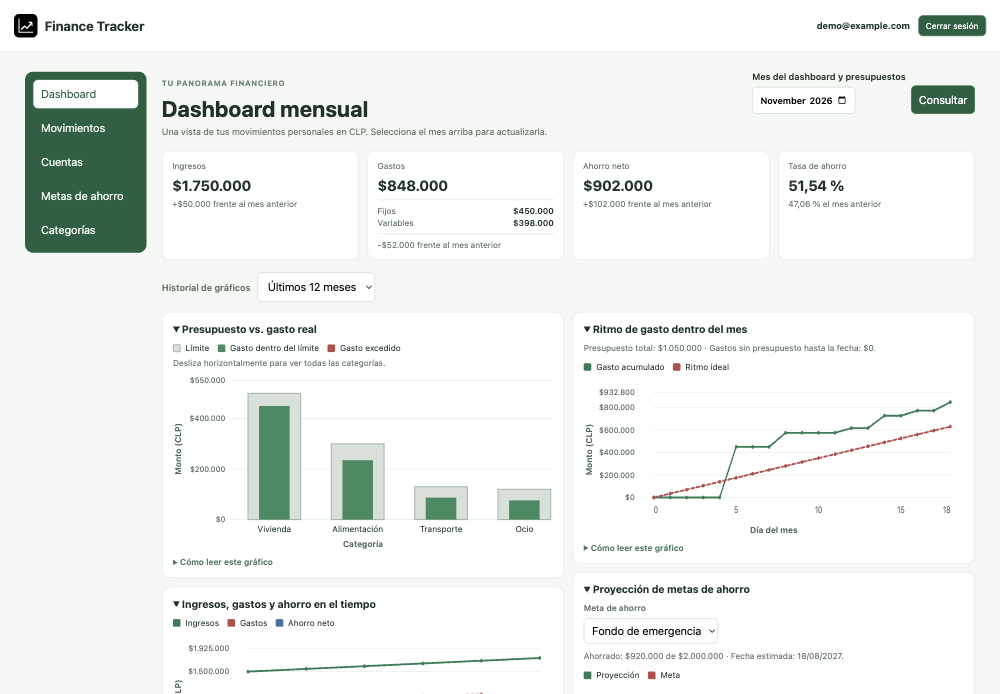
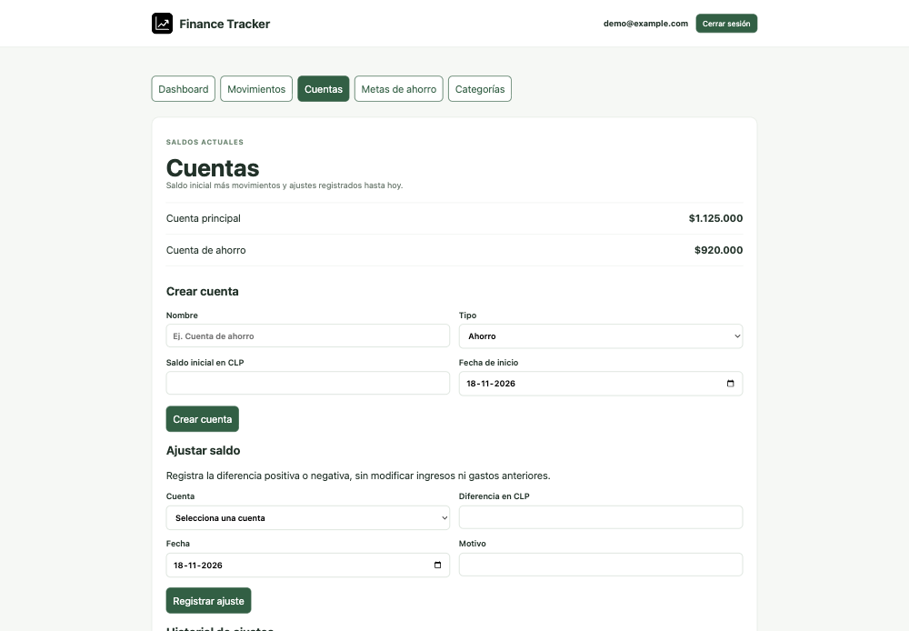
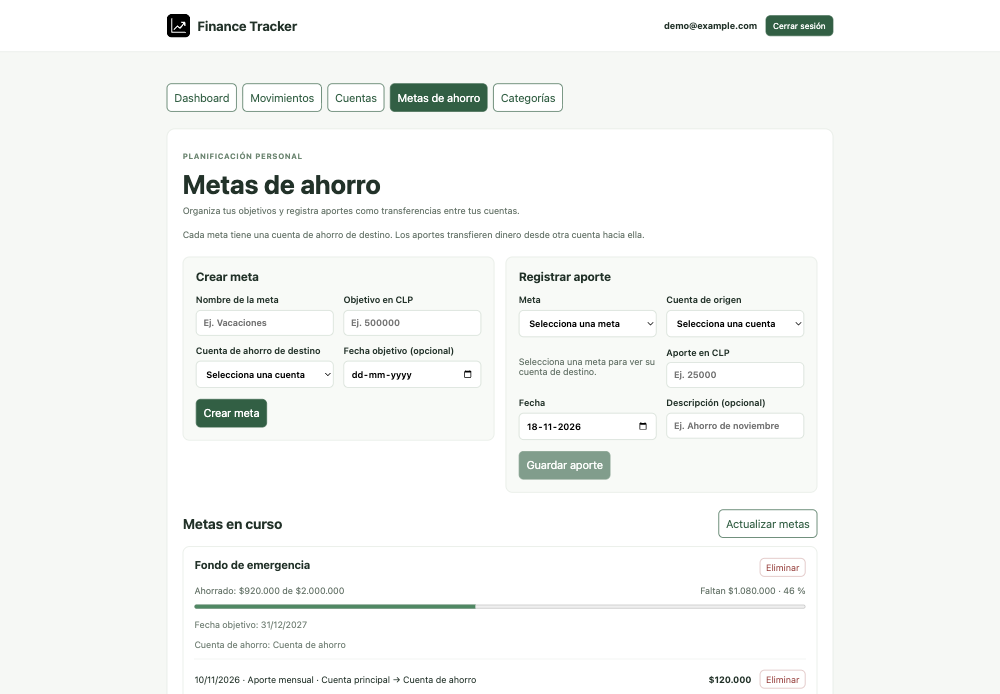

# Finance Tracker

<p align="center">
  
</p>

<p align="center">
  <strong>Tus finanzas personales, en un solo lugar.</strong><br />
  Registra tus movimientos, organiza tus presupuestos y sigue tus metas de ahorro.
</p>

<p align="center">
  <a href="https://finance-tracker-akxi.onrender.com/"><strong>Visita Finance Tracker</strong></a>
</p>

<p align="center">
  
  
  
  
</p>

## 👋 ¿Qué es Finance Tracker?

Finance Tracker es una aplicación web para llevar un seguimiento personal de
ingresos, gastos y ahorro en pesos chilenos (CLP). Reúne tus movimientos y
cuentas en un dashboard para ayudarte a entender cómo evoluciona tu dinero.

La aplicación está enfocada en el uso individual. Compartir un hogar y
presupuestos con otras personas es una idea para una etapa posterior.

## ✨ Funcionalidades principales

> Las capturas muestran datos ficticios preparados para ilustrar la interfaz.

### 📊 Dashboard mensual

Consulta ingresos, gastos, ahorro neto y tasa de ahorro; compara presupuestos
con gastos y explora gráficos interactivos de categorías, tendencias, saldos,
ritmo de gasto y proyección de metas.



### 💸 Movimientos

Registra ingresos y egresos, transfiere dinero entre cuentas y consulta el
historial. Puedes filtrar por fechas, tipo, categoría, descripción y cuenta,
además de editar o eliminar registros.


### 🏦 Cuentas

Crea cuentas, define sus saldos iniciales y consulta sus saldos actuales.
También puedes registrar ajustes sin convertirlos en ingresos o gastos.



### 🗂️ Categorías y presupuestos

Personaliza categorías de gasto, clasifícalas como fijas o variables y
configura un presupuesto por categoría y mes. Puedes archivar categorías sin
borrar su historial.


### 🎯 Metas de ahorro

Crea metas asociadas a una cuenta de ahorro y revisa su progreso. Cada aporte
se registra como una transferencia desde otra cuenta y modifica sus saldos;
las metas completadas aparecen en un apartado separado.



## 🌐 Pruébalo en línea

### 👉 [finance-tracker-akxi.onrender.com](https://finance-tracker-akxi.onrender.com/)

Puedes crear una cuenta con correo y contraseña para comenzar. La aplicación
usa el plan gratuito de Render, por lo que puede tardar en responder después
de un período de inactividad.

> **Antes de guardar información financiera real:** el registro es público y
> aún no hay verificación de correo, recuperación de contraseña ni
> autenticación multifactor. Usa una contraseña segura y mantén respaldos
> cifrados independientes. Consulta la
> [guía de seguridad y respaldos](./docs/guia-tecnica.md#preparación-remota-gratuita-render-y-neon).

## ☁️ Despliegue

| Parte | Servicio | Función |
| --- | --- | --- |
| Aplicación y API | [Render](https://render.com/) | Sirve la interfaz y ejecuta el backend desde `main` |
| Base de datos | [Neon](https://neon.tech/) | Aloja PostgreSQL |

Los planes gratuitos tienen límites y pueden cambiar. Render puede suspender
la aplicación por inactividad y Neon tiene límites de uso y almacenamiento.
Para desplegar tu propia instancia, revisa la
[configuración remota](./docs/guia-tecnica.md#preparación-remota-gratuita-render-y-neon)
y nunca publiques credenciales.

## 🧰 Tecnologías

| Área | Tecnologías |
| --- | --- |
| Interfaz | HTML, CSS y JavaScript, sin framework |
| Backend | Python, FastAPI y psycopg |
| Base de datos | PostgreSQL |
| Pruebas | Node.js, jsdom y unittest |

## 🗂️ Estructura del proyecto

```text
.
├── assets/           # Logo de la aplicación
├── backend/          # API, servidor y herramientas de base de datos
├── db/
│   ├── migrations/   # Esquema y migraciones de PostgreSQL
│   └── seeds/        # Datos ficticios opcionales
├── docs/             # Guía técnica y capturas
├── frontend/         # Interfaz web y módulos JavaScript
└── tests/            # Pruebas del backend y frontend
```

## 🚀 Cómo ejecutarlo en tu equipo

Necesitas Python 3.10 o posterior, Node.js 22 o posterior, npm, PostgreSQL y
el cliente `psql`.

### 1. Prepara la base de datos

Crea una base PostgreSQL **nueva y vacía**, configura la conexión local y
ejecuta las migraciones 001 a 012 en orden siguiendo
[Preparar una base nueva](./docs/guia-tecnica.md#preparar-una-base-nueva).
La aplicación usa `finance_tracker` por defecto; también puedes configurar
`DATABASE_URL` o las variables habituales de PostgreSQL.

> Las migraciones no son repetibles y no existe un registro automático de las
> aplicadas. No las vuelvas a ejecutar sobre una base preparada: respáldala y
> aplica solo las pendientes en orden.

### 2. Instala y ejecuta la aplicación

Desde la raíz del proyecto:

```bash
python3 -m venv .venv
.venv/bin/python -m pip install -r backend/requirements-test.txt
npm install
npm start
```

Abre [http://127.0.0.1:3000](http://127.0.0.1:3000) y crea tu cuenta.
Para detener el servidor, presiona `Ctrl+C`. Para cambiar de puerto, usa por
ejemplo `PORT=3001 npm start`.

La [guía técnica](./docs/guia-tecnica.md) incluye las migraciones completas,
datos ficticios opcionales, configuración remota, comportamiento de las
funciones y respaldo y restauración.

## ✅ Pruebas

Desde la raíz:

```bash
npm test
```

Las pruebas de integración con PostgreSQL se omiten por defecto. La
[guía técnica](./docs/guia-tecnica.md#api-python) explica cómo ejecutarlas
en bases temporales separadas.

## 🔭 Próximos pasos

La prioridad es seguir mejorando el seguimiento financiero personal. Más
adelante se podría incorporar el uso compartido del hogar con invitaciones,
permisos y presupuestos. La verificación de correo, la recuperación de
contraseña y la autenticación multifactor también son mejoras pendientes.

## 🤝 Estado y contribuciones

Finance Tracker sigue en desarrollo. Las sugerencias y contribuciones son
bienvenidas; para cambios grandes, abre primero una conversación o un issue.
Trabaja en una rama de funcionalidad y abre un pull request hacia `main`.

## 📄 Licencia

Este repositorio aún no incluye un archivo de licencia. No se debe asumir que
el código puede reutilizarse o redistribuirse sin autorización.
