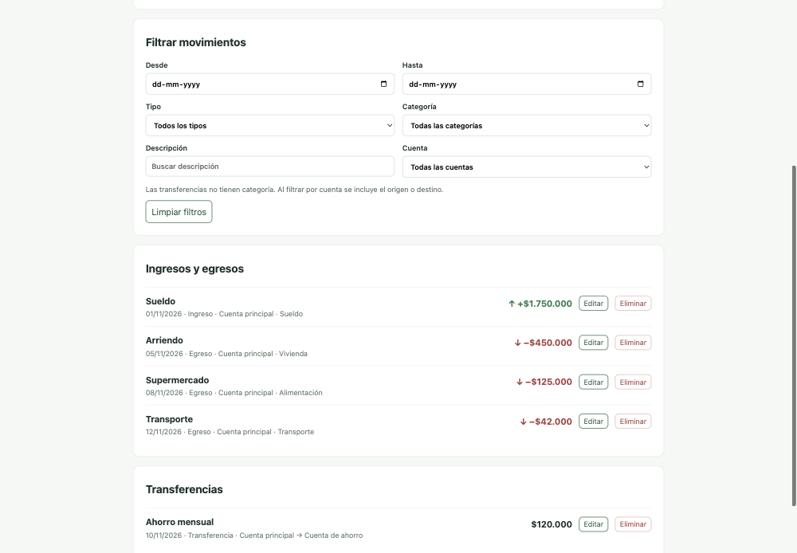
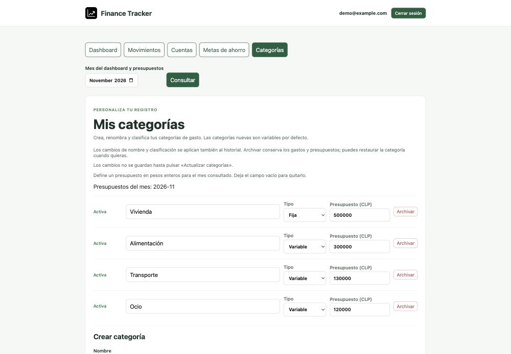

# Finance Tracker

<p align="center">
  
</p>

<p align="center">
  <strong>Tus finanzas personales, en un solo lugar.</strong><br />
  Registra tus movimientos, organiza tus presupuestos y sigue tus metas de ahorro.
</p>

<p align="center">
  <a href="https://finance-tracker-akxi.onrender.com/"><strong>Visita Finance Tracker</strong></a>
</p>

<p align="center">
  
  
  
  
</p>

## 👋 ¿Qué es Finance Tracker?

Finance Tracker es una aplicación web para llevar el control de tus ingresos, gastos y ahorro en pesos chilenos (CLP). Junta tus movimientos y cuentas en un dashboard para que puedas ver fácilmente cómo evoluciona tu plata.

Desarrollé Finance Tracker con la ayuda de GitHub Copilot, que me acompañó durante la programación y documentación del proyecto.

## ✨ Funcionalidades principales

> Las capturas usan datos ficticios, preparados solo para mostrar la interfaz.

### 📊 Dashboard mensual

Revisa tus ingresos, gastos, ahorro neto y tasa de ahorro, y compara tus presupuestos con lo que realmente has gastado. Incluye gráficos interactivos de categorías, tendencias, saldos, ritmo de gasto y proyección de metas.


### 💸 Movimientos

Registra tus ingresos y egresos, transfiere plata entre cuentas y revisa tu historial. Puedes filtrar por fechas, tipo, categoría, descripción y cuenta, y también editar o eliminar cualquier registro.



### 🏦 Cuentas

Crea tus cuentas, define sus saldos iniciales y consulta cuánto tienes en cada una. Además, puedes registrar ajustes de saldo sin que cuenten como ingresos ni gastos.


### 🗂️ Categorías y presupuestos

Personaliza tus categorías de gasto y clasifícalas como fijas o variables. Luego define un presupuesto para cada categoría y cada mes. Si una categoría ya no te sirve, puedes archivarla sin perder su historial.



### 🎯 Metas de ahorro

Crea metas asociadas a una cuenta de ahorro y sigue tu avance. Cada aporte se registra como una transferencia desde otra cuenta, así que los saldos se actualizan solos. Las metas cumplidas pasan a una sección aparte.


## 🌐 Pruébalo en línea

### 👉 [finance-tracker-akxi.onrender.com](https://finance-tracker-akxi.onrender.com/)

Para empezar, solo tienes que crear una cuenta con tu correo y una contraseña. La app corre en el plan gratuito de Render, así que si lleva un rato sin uso puede demorarse en responder la primera vez.

> **Antes de guardar información financiera real:** el registro es público y todavía no hay verificación de correo, recuperación de contraseña ni autenticación multifactor. Usa una contraseña segura y mantén tus propios respaldos cifrados. Puedes revisar la
> [guía de seguridad y respaldos](./docs/guia-tecnica.md#preparación-remota-gratuita-render-y-neon).

## ☁️ Despliegue

| Parte | Servicio | Función |
| --- | --- | --- |
| Aplicación y API | [Render](https://render.com/) | Sirve la interfaz y ejecuta el backend desde `main` |
| Base de datos | [Neon](https://neon.tech/) | Aloja PostgreSQL |

Los planes gratuitos tienen límites y pueden cambiar con el tiempo: Render suspende la app cuando no se usa y Neon limita el uso y el almacenamiento. Si quieres desplegar tu propia instancia, sigue la
[configuración remota](./docs/guia-tecnica.md#preparación-remota-gratuita-render-y-neon) y nunca publiques tus credenciales.

## 🧰 Tecnologías

| Área | Tecnologías |
| --- | --- |
| Interfaz | HTML, CSS y JavaScript, sin framework |
| Backend | Python, FastAPI y psycopg |
| Base de datos | PostgreSQL |
| Pruebas | Node.js, jsdom y unittest |

## 🗂️ Estructura del proyecto

```text
.
├── assets/           # Logo de la aplicación
├── backend/          # API, servidor y herramientas de base de datos
├── db/
│   ├── migrations/   # Esquema y migraciones de PostgreSQL
│   └── seeds/        # Datos ficticios opcionales
├── docs/             # Guía técnica y capturas
├── frontend/         # Interfaz web y módulos JavaScript
└── tests/            # Pruebas del backend y frontend
```

## 🚀 Cómo ejecutarlo en tu equipo

Necesitas Python 3.10 o superior, Node.js 22 o superior, npm, PostgreSQL y el cliente `psql`.

### 1. Prepara la base de datos

Crea una base PostgreSQL **nueva y vacía**, configura la conexión local y ejecuta las migraciones de la 001 a la 012, en orden, siguiendo las instrucciones de
[Preparar una base nueva](./docs/guia-tecnica.md#preparar-una-base-nueva).
Por defecto la app usa una base llamada `finance_tracker`, pero también puedes configurar `DATABASE_URL` o las variables habituales de PostgreSQL.

> Las migraciones no se pueden repetir y la app no lleva un registro de cuáles ya se aplicaron. No las vuelvas a ejecutar sobre una base ya preparada: haz un respaldo y aplica solo las que falten, en orden.

### 2. Instala y ejecuta la aplicación

Desde la raíz del proyecto:

```bash
python3 -m venv .venv
.venv/bin/python -m pip install -r backend/requirements-test.txt
npm install
npm start
```

Abre [http://127.0.0.1:3000](http://127.0.0.1:3000) y crea tu cuenta. Para detener el servidor, presiona `Ctrl+C`. Si quieres usar otro puerto, puedes hacerlo así: `PORT=3001 npm start`.

En la [guía técnica](./docs/guia-tecnica.md) encontrarás las migraciones completas, los datos ficticios opcionales, la configuración remota, el detalle de cómo funciona cada parte y cómo respaldar y restaurar tus datos.

## ✅ Pruebas

Desde la raíz del proyecto:

```bash
npm test
```

Las pruebas de integración con PostgreSQL no se ejecutan por defecto. En la
[guía técnica](./docs/guia-tecnica.md#api-python) se explica cómo correrlas en bases temporales separadas.

## 🔭 Próximos pasos

Lo próximo que quiero agregar es el modo **hogar**: que varias personas puedan compartir presupuestos y llevar sus finanzas de forma conjunta.

## 🤝 Estado y contribuciones

Finance Tracker sigue en desarrollo. Las sugerencias y contribuciones son bienvenidas; si se trata de un cambio grande, abre antes una conversación o un issue. Trabaja en una rama aparte y abre un pull request hacia `main`.

## 📄 Licencia

Este repositorio todavía no incluye un archivo de licencia, así que no se debe asumir que el código se puede reutilizar o redistribuir sin autorización.